The Analysis pages support a [regular review](/fms-insight/improve-fms) of cell performance. Select
the last 30 days or a calendar month, then choose a report from the navigation. Use a wider period
to find patterns and individual cycles or material histories to investigate their causes.

Available data depends on the integration and the schedules supplied to Insight. In particular,
simulated station use and projected completions require simulation results in the downloaded jobs. A
missing measurement or forecast should not be interpreted as zero activity.

## Efficiency

### Buffer Occupancy

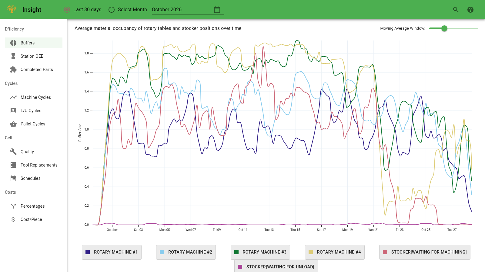

Material can wait in the stocker, at machine buffers, or in transfer queues between processes. The
buffer chart shows a moving average of the quantity waiting in these locations. Adjust the averaging
window to reveal trends without being distracted by individual pallet movements.

A growing buffer can point to a downstream constraint. For example, material waiting to unload may
indicate that loading and unloading are falling behind, while empty machine input buffers may help
explain idle machines. Compare these patterns with station use and the part mix. The chart
identifies where to investigate; it cannot by itself distinguish staffing, tooling, downtime, or
scheduling causes. The locations shown depend on the events available from the controller.

### Station Use

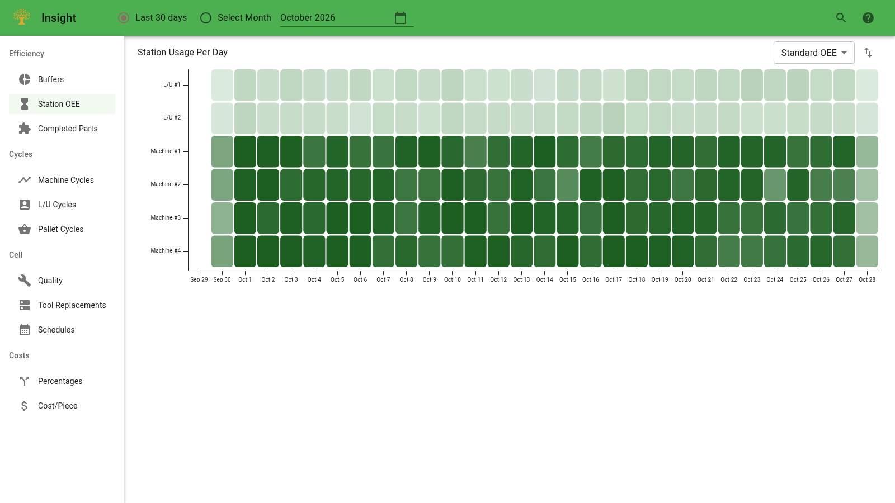

The Station OEE report shows one row per station and one column per day. Darker cells represent
higher percentages; hover for the value. Choose one of three views:

| View         | What it measures                                                             |
| ------------ | ---------------------------------------------------------------------------- |
| Standard OEE | Active time credited to recorded cycles, relative to available time.         |
| Planned OEE  | Simulated station use from downloaded schedules, relative to available time. |
| Occupied     | Recorded elapsed cycle time, relative to available time.                     |

Available time is 24 hours per day minus planned downtime supplied with the simulation. Active time
normally represents the expected operation time supplied by the integration, rather than measured
cutting time. Where active time is absent, the client can estimate it from typical cycles. The
Occupied view uses recorded cycle durations; it is not a separate sensor measurement of every moment
a pallet is physically present.

For example, a cycle with 25 minutes of active time and 40 minutes elapsed contributes 25 minutes to
Standard OEE and 40 minutes to Occupied. A repeated gap is worth investigating alongside the
expected times and cycle histories. These reports do not independently apply a good-parts quality
factor; review inspection and disposition information as well.

Compare machines across the same days to look for imbalance, then use the part production report to
understand the mix that ran. A lightly used machine may reflect downtime or limited route
flexibility; it does not necessarily mean more work should be assigned to it.

### Part Production

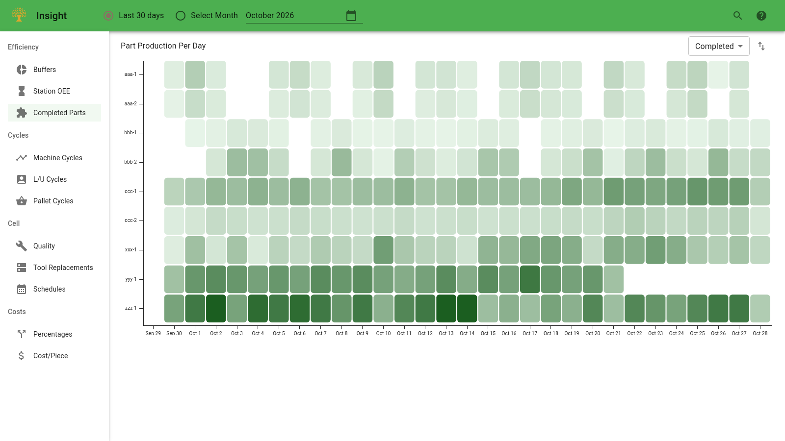

The Completed Parts heatmap groups production by part and process. Its color represents the
associated active machine hours, while the tooltip shows both quantity and hours. Switch between
Completed and Planned to compare recorded unloads with simulated production.

A completed process is not necessarily a finished part, and production counts do not establish
quality acceptance. Use the report to compare the part mix and resource demand across days. Evaluate
proposed route or capacity changes with engineering review and simulation, such as
[SeedTactic: Planning](https://www.seedtactics.com/features#seedtactic-planning), before changing
the cell.

## Cycle Analysis

### Machine Cycles

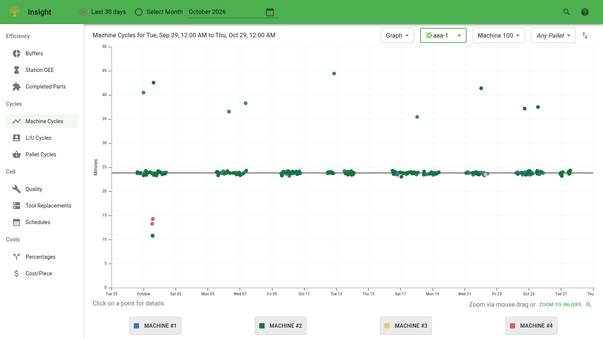

Each point is a recorded program cycle. Filter by part, program, machine, or pallet, and zoom to a
period of interest. Select a point to see the cycle details and associated material. The vertical
axis is elapsed wall-clock time, including interruptions.

For a selected part and program, the gray band shows typical cycle times based on the median and
median absolute deviation. The horizontal reference line shows the expected active time. A
persistent difference between the band and reference line suggests reviewing the planning inputs;
scattered high points suggest investigating individual interruptions.

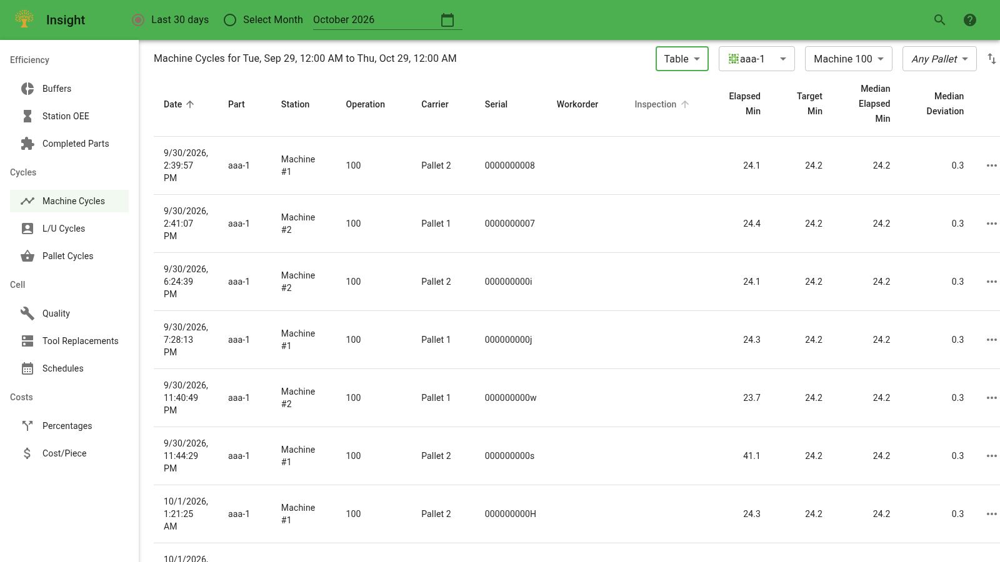

Switch to the table to sort and compare records, or copy the displayed data to a spreadsheet.

### Load/Unload Cycles

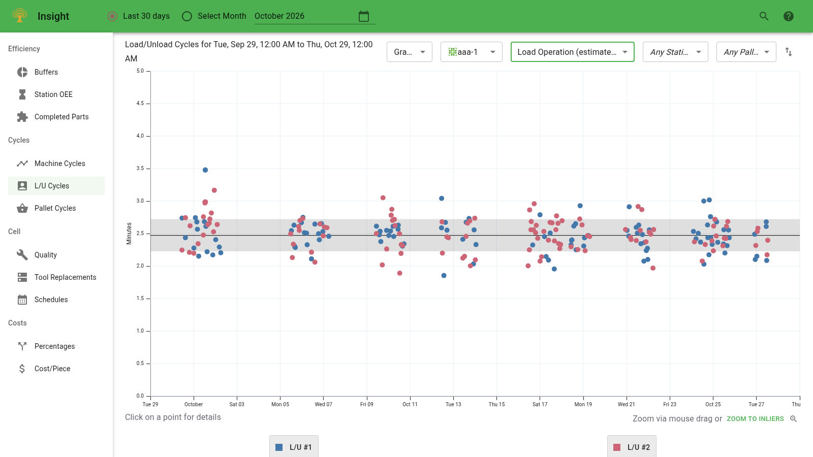

The load/unload report distinguishes recorded station occupancy from estimated time for each load or
unload operation. A single station visit can include several parts and operations, so Insight cannot
infer the time spent on each one from the total duration alone.

For ordinary pallet work, it apportions elapsed time using expected operation times. If one load is
expected to take five minutes and one unload eight minutes, a 15-minute visit is split in the ratio
5:8, approximately 5.8 and 9.2 minutes. These are estimates, not separate stopwatch measurements.
Filter by part, pallet, or basket where available to investigate repeated patterns.

Basket load/unload work is included when the integration records it. Transfers between a pallet and
a basket are represented without counting their companion records as a second timed operation.

### Pallet Cycles

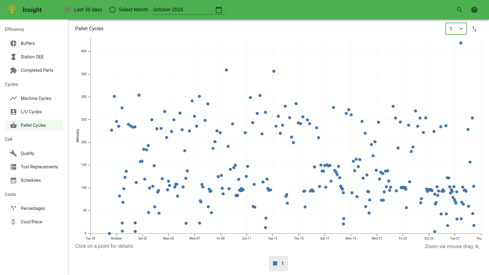

Select a pallet to examine its recorded cycle durations. These cover the pallet's circulation
through the cell, including the transfer, waiting, and processing intervals included by the
integration. Long or irregular cycles can reveal flow problems that are not obvious from machine
times alone. Select a point for the associated material and investigate the corresponding station
activity.

Use this alongside the
[daily allocation approach](https://www.seedtactics.com/tactics/preventing-traffic-jams) to review
how much work is circulating and whether queues or competing pallets are delaying flow.

### Basket Cycles

Where basket cycle history is available, a separate report shows basket cycle durations. Select a
basket or part and process, then inspect individual points and their material. The installation may
use another name for baskets. These cycles describe basket circulation and are separate from the
load/unload operations performed at a station.

## Cell

### Quality

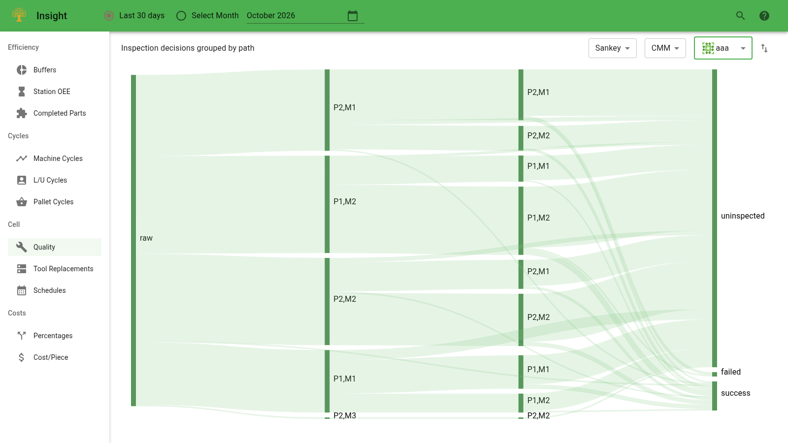

The quality report groups recorded manufacturing paths and inspection outcomes for the selected
period. Choose a part and inspection type, then use the Sankey diagram or table to compare paths.
See the [Quality pages](/fms-insight/client-quality#paths) for how to interpret the results.

### Tool Replacements

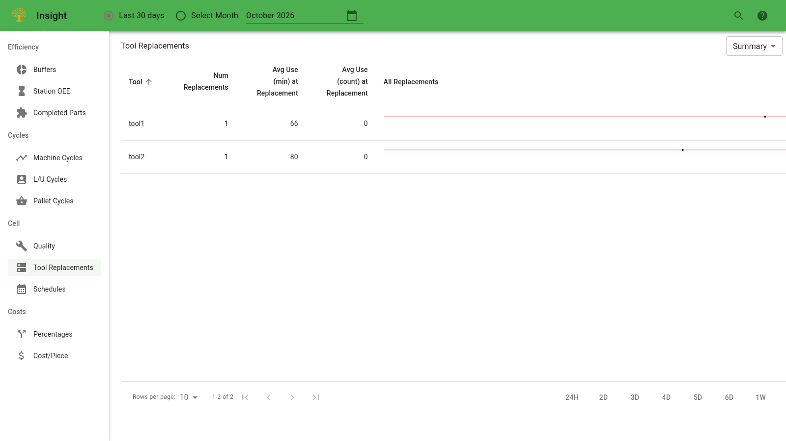

Where tool data is supplied, this report shows replacements and the recorded usage or count at
replacement. Each tool's graph shows individual replacements and their average. Replacements during
a cycle may have approximate usage values because the exact replacement time is not known.

### Schedules

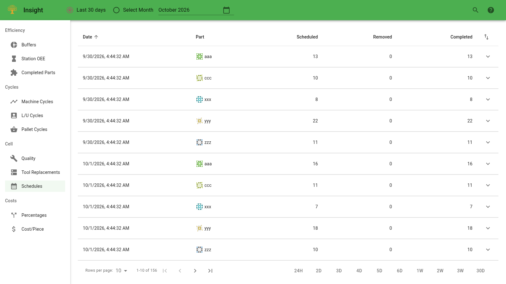

The schedules report lists jobs for the selected period. Expand a job to review its routes,
quantities, and recorded serials. Use it to connect the production reports with the work that was
scheduled.

## Cost/Piece

Cost allocation helps compare periods and assess whether a process change has reduced cost per
piece. Insight sees the cell's production and resource use; overhead, material cost, and other
business costs may need to be added in a spreadsheet or ERP report.

### Percentages

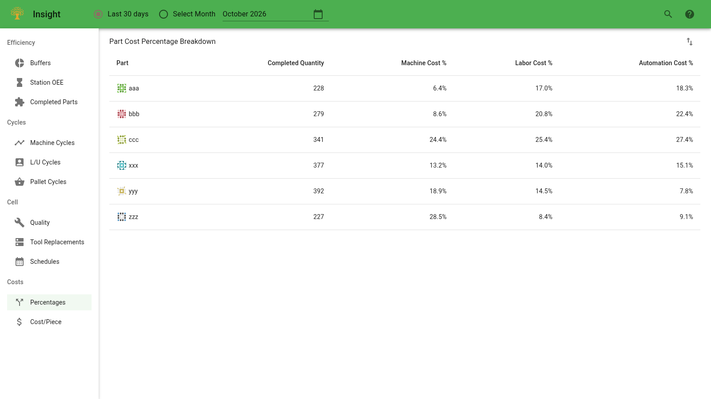

The Percentages report divides resource use among the parts produced in the selected period. Machine
and labor shares use active time from recorded cycles; automation shares use unload-cycle counts.
These weights allocate a share of the total resource cost, including its idle time, to each part
type.

For example, if two part types account for 1,200 and 1,000 active machine hours in a group, their
shares of that group's cost are approximately 54.5% and 45.5%. The percentages describe how cost is
allocated, not why time was lost. Use the efficiency and cycle reports to investigate losses.

Copy the percentages to a spreadsheet or ERP to combine them with your own cost model. Check the
period, completed quantities, and active-time inputs before interpreting the results.

### Part Cost/Piece

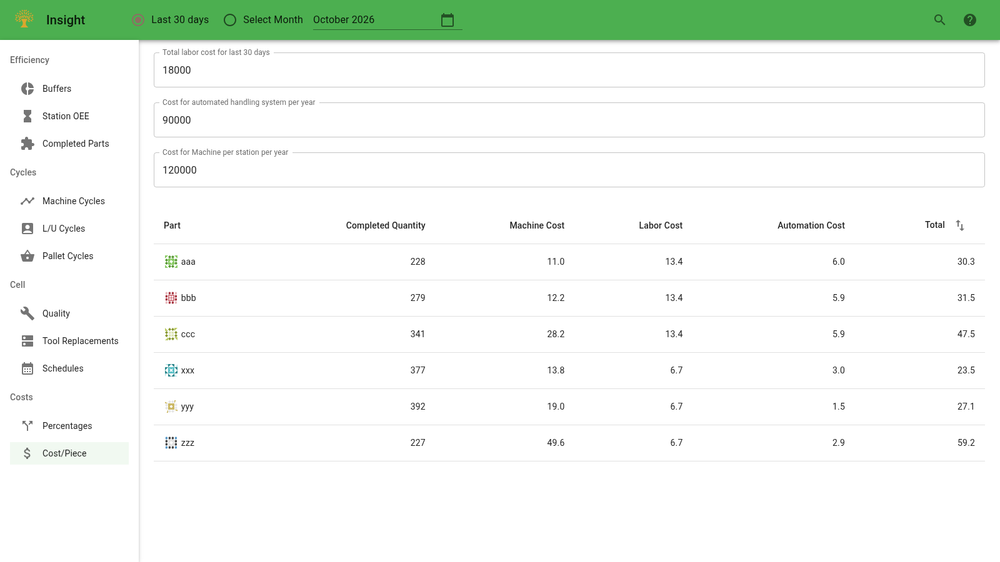

Enter the resource costs using the units shown on the page. Insight applies the allocation
percentages and completed quantities to estimate cost per piece. This is a cell-level estimate;
combine it with other costs and quality information for a complete business comparison.
