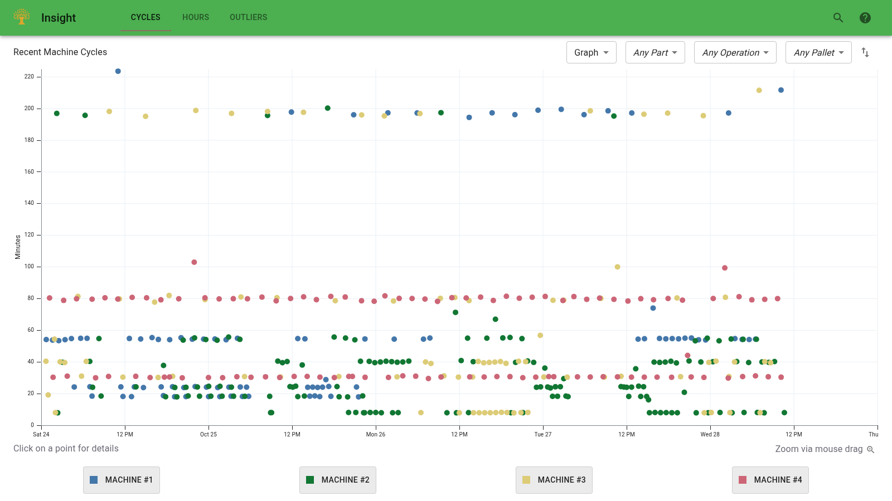
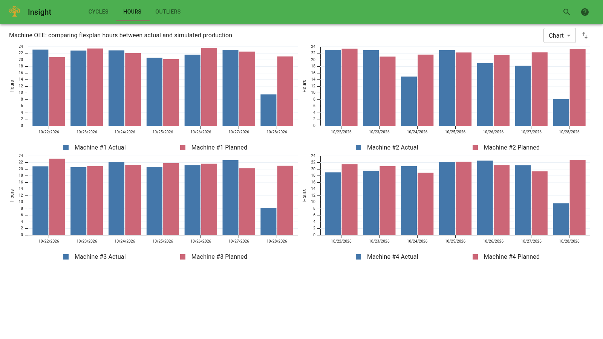
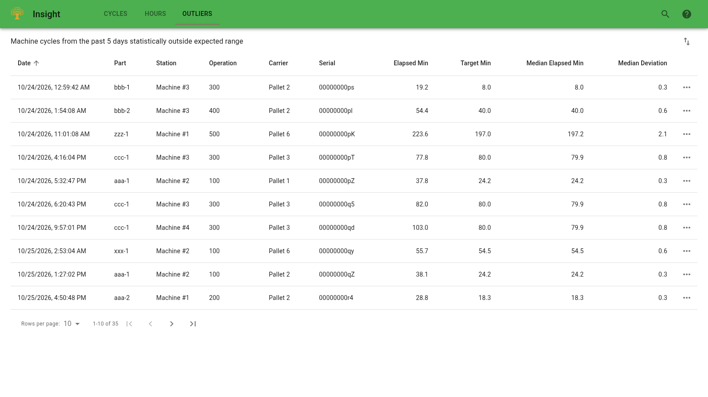

The Engineering pages help part-programming and manufacturing engineers review recent machine
activity. They are useful after introducing a program or when investigating recurring interruptions.
The same reports are available from [Operations](/fms-insight/client-operations#reports).

## Cycles

The cycle chart initially shows the past five days. Filter by part, program, pallet, or station,
zoom to a time range, and select a point to inspect the cycle and its material. A table view makes
it easier to compare individual records or copy data to a spreadsheet.

Cycle time is elapsed wall-clock time, including interruptions. When a part and program are
selected, the statistical band shows typical recent times and the horizontal reference line shows
the expected active time. A persistent difference may mean the planned time needs review; isolated
long cycles may have a different cause.
[Monthly cycle analysis](/fms-insight/client-efficiency#machine-cycles) provides a wider view.

## Hours

The Hours view compares active hours credited to recorded cycles with simulated hours for the past
seven days. These active hours represent expected productive time rather than the full elapsed time
of interrupted cycles. Switch between the chart and table to compare machines and days. Use the
[Analysis pages](/fms-insight/client-efficiency) for older periods and broader comparisons.

## Outliers

The Outliers view lists cycles from the past five days whose elapsed time is outside the typical
range. Insight estimates that range using the median and median absolute deviation, reducing the
influence of occasional long interruptions.

An outlier is a reason to investigate, not a diagnosis. Review the material history, program,
tooling, and circumstances of the cycle. Separately compare typical cycle times with the expected
times used for planning; a consistently unrealistic planned time may not appear as an outlier.
