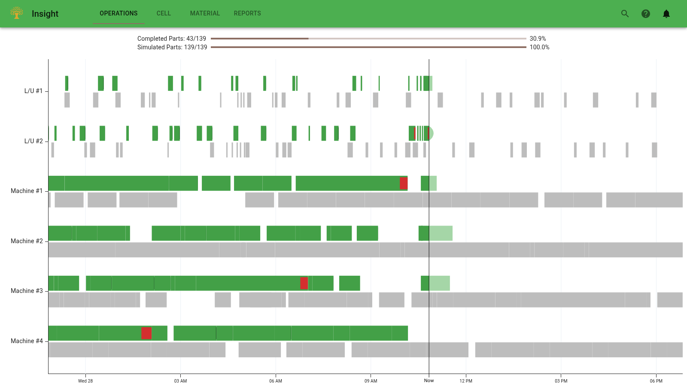
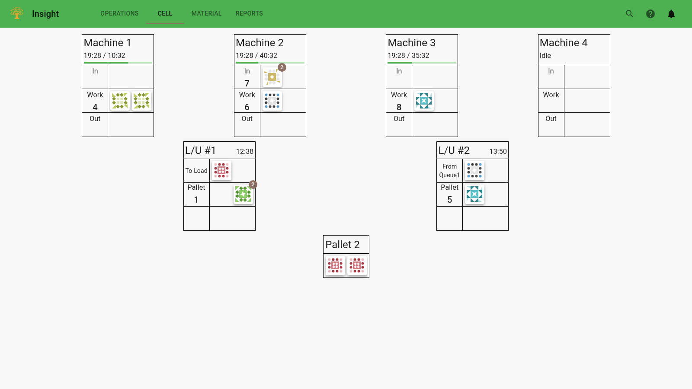
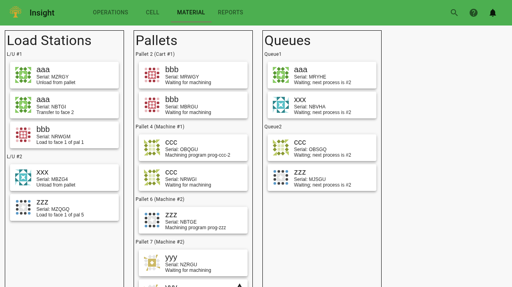
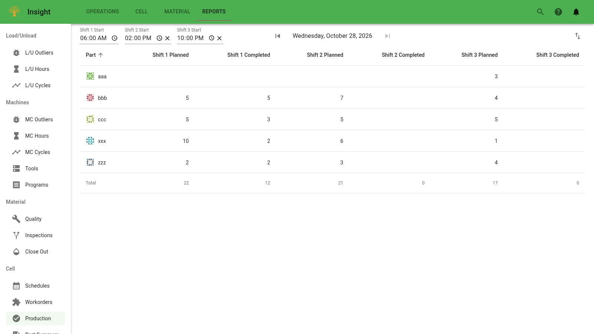

The Operations pages give the floor supervisor a shared view of the cell and recent production.
Bookmark the dashboard for daily monitoring. Use the page navigation to switch between the
Dashboard, Cell, Material, and Reports; individual reports appear in a sidebar or a selector on
smaller screens. Available reports depend on the installation.

## Dashboard

The progress bars compare completed production with the simulation for active schedules. Each
completed process counts separately, so these totals are not a count of finished, accepted parts.
The simulated total is the quantity expected by the current time from the downloaded schedule.
Differences are a starting point for investigation rather than proof of a particular problem.

The chart places recent actual cycles beside simulated station use, with a vertical line marking the
current time. Green bars show actual activity, gray bars show planned activity, and lighter green
shows estimated remaining time for work in progress. Longer cycles can have a dark green or red
extension, with red highlighting statistical outliers. Select a cycle for details.

Simulated activity is a forecast from the schedule. It does not continuously reschedule itself to
match delays on the floor.

## Cell

The Cell view shows machines, load stations, pallets, and their material. Where supported, baskets
and their locations are also included. Open a material card for its details. This is the same system
overview available on the [station pages](/fms-insight/client-station-monitor#system-overview).

## Material

The Material view groups material by pallets, baskets where used, and configured queues. It is
useful for seeing both work inside automation and material waiting outside it.

Material can be moved between permitted quarantine queues using the card's drag handle. Changes to
production queues belong on the [Queues station page](/fms-insight/client-station-monitor#queues),
where operators can check the physical material. Actions are also restricted by the material's
current state.

## Reports

Reports cover recent load and machine cycles, outliers, hours, inspections, closeouts, schedules,
workorders, and production. Part Summary brings together production information by part. Some
installations also offer rebooking requests for additional production.

The same information is available through dedicated pages for
[engineering](/fms-insight/client-engineering), [quality](/fms-insight/client-quality),
[tools and programs](/fms-insight/client-tools-programs), and [sales](/fms-insight/client-sales).
Choose the page that fits the question: a recent cycle for a current interruption, a material
history for a traceability issue, or [monthly analysis](/fms-insight/client-efficiency) to look for
longer-term patterns.
