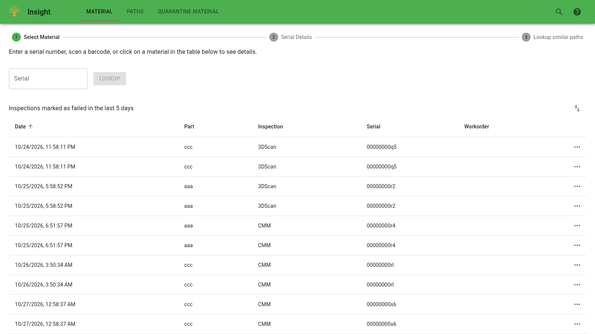
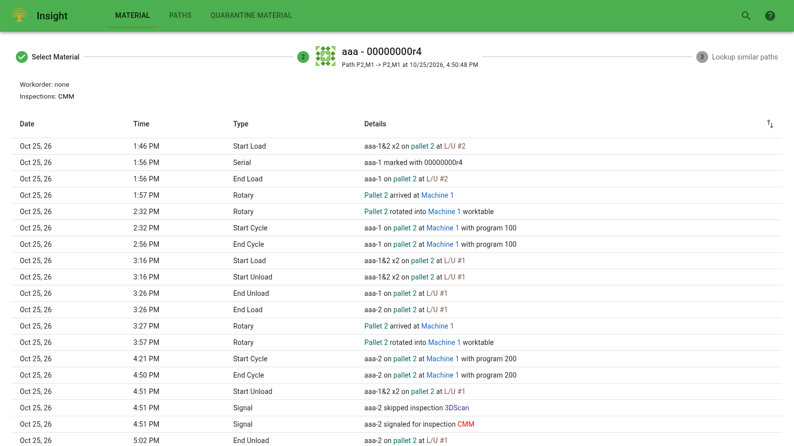
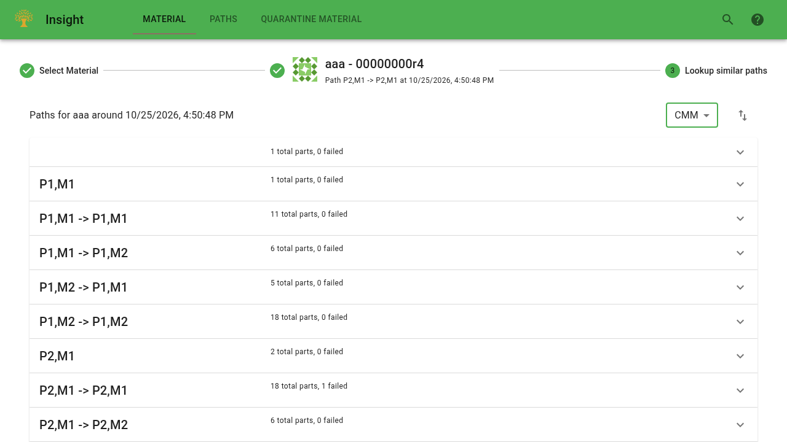
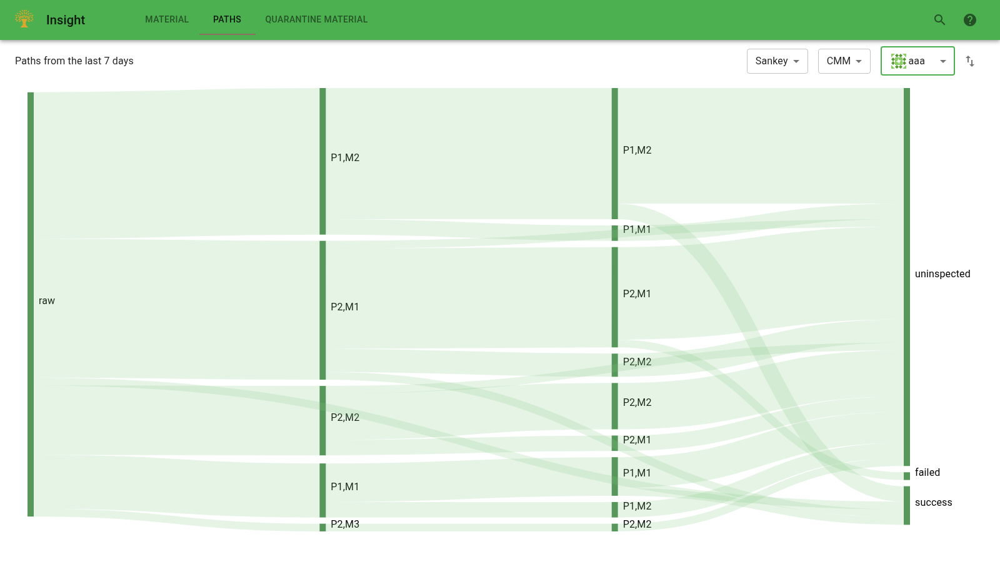

The Quality pages bring together material histories, inspection results, and material on hold.
Bookmark this page for quality investigations; the same reports are also available through
[Operations](/fms-insight/client-operations#reports).

## Material

Enter or [scan](/fms-insight/client-scanners) a serial, or select a recent failed inspection, to
review the material's history. This lookup can also be used after a part has left the cell.

The record shows the available production events, machines, pallets or baskets, inspections, and
notes. Use **Lookup Similar Paths** to investigate other material that followed related routes.
Review the displayed search period and extend it when the investigation requires more history.

The results group material by path and inspection type. Expand a row to see the individual serials.
Sharing a path helps identify material to investigate; it does not establish that every piece has
the same defect.

## Paths

The Paths view summarizes the last seven days by part and inspection type. Select both to view a
Sankey diagram or a table. For older periods, use the
[monthly quality report](/fms-insight/client-efficiency#quality).

In the diagram, material flows from left to right through its recorded pallet and machine path to
its inspection outcome. Wider links represent more pieces. Hover a link for details or switch to the
table to inspect individual paths and serials. Not every piece is selected for inspection, so
uninspected material must not be interpreted as an inspection success.

## Quarantine Material

Where [quarantine](/fms-insight/material-quarantine) is configured, this view shows material in the
quarantine queues. Open a card to review its history and add notes, or drag its handle to move
waiting material between permitted queues. Use the
[Queues station page](/fms-insight/client-station-monitor#queues) when returning released material
to production.

Moving material between queues does not by itself record an inspection result or a decision to scrap
or release the material. Follow the installation's disposition procedure so the material's location
and quality records remain aligned.
