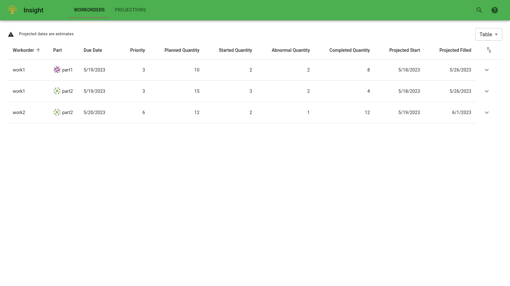
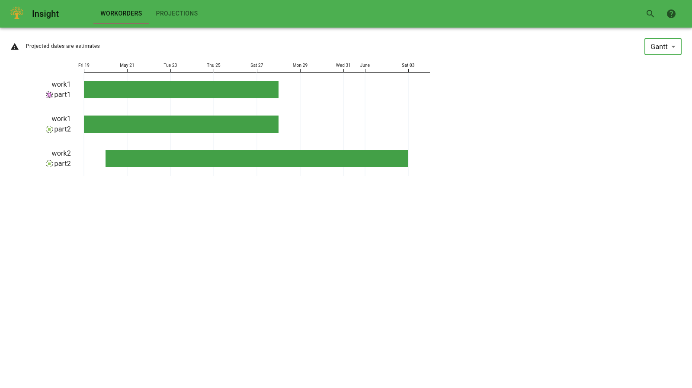
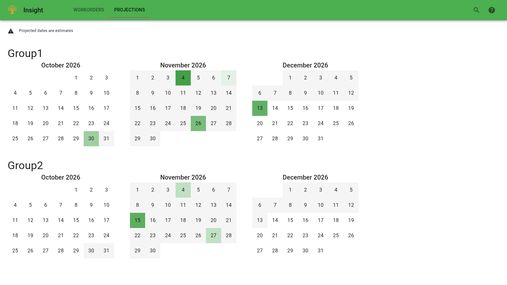

The Sales pages show workorder progress and, where supplied, simulation estimates for upcoming
production. They help sales and planning staff discuss delivery dates and available capacity.

## Workorders

The table lists current workorders and their quantities and dates. Expand a workorder to review
assigned material, recorded station time, and comments. Comments provide a shared place for
operators, supervisors, and sales staff to record information about the order.

Projected start and filled dates appear when the downloaded schedule includes workorder simulation
results. These dates describe the simulation at the time it was run. They do not continuously update
for delays, priority changes, or new orders; a new simulation is needed to revise the forecast.

Where projected dates are available, switch to the Gantt chart to compare workorders over time.
Treat the dates as estimates based on the modeled part mix, routes, and available resources.

## Projected Usage

The projected usage calendar shows the simulation's expected machine utilization for remaining
workorders. Darker days indicate greater use; hover a day for its value. This report requires
simulation details in the downloaded schedule and, like the projected workorder dates, changes when
new simulation results are supplied.

Use the calendar to identify periods worth considering for additional work. A lightly loaded day is
not a delivery promise: the new part's qualified machines, tooling, material, and priority still
need to be considered in the schedule.
