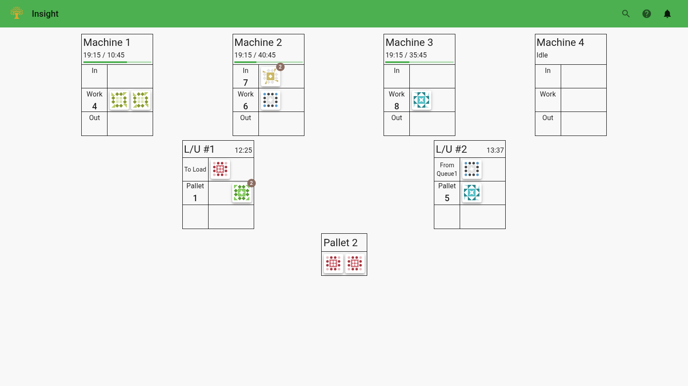
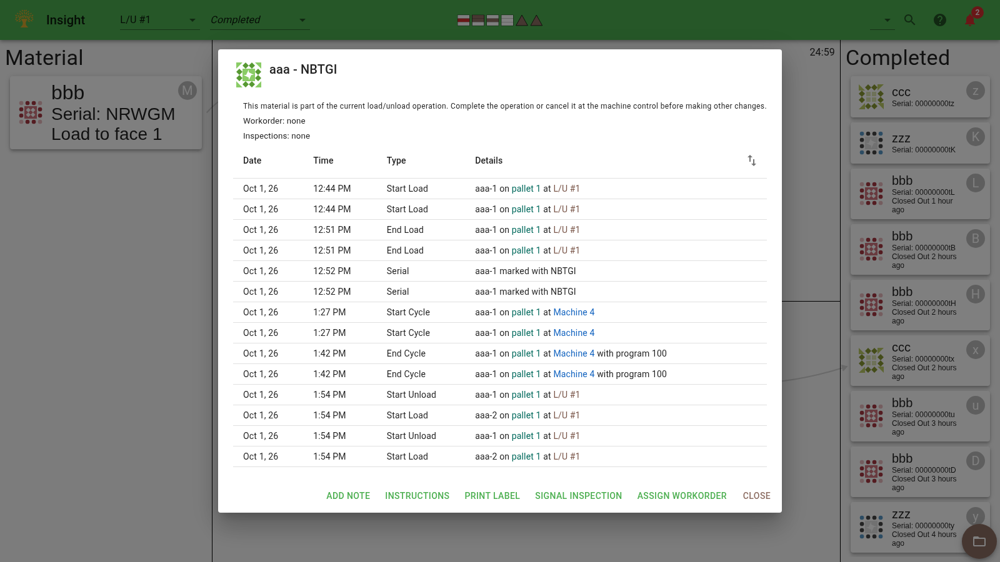
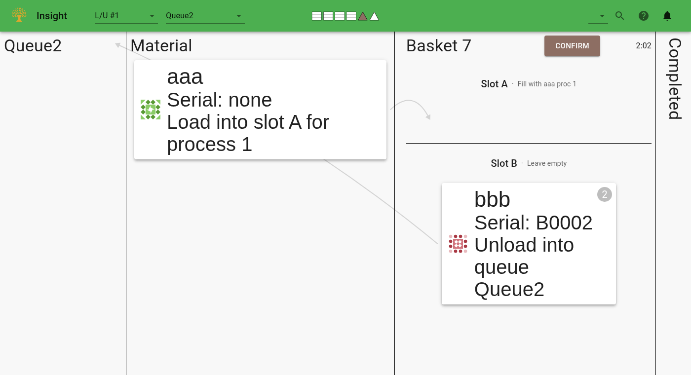
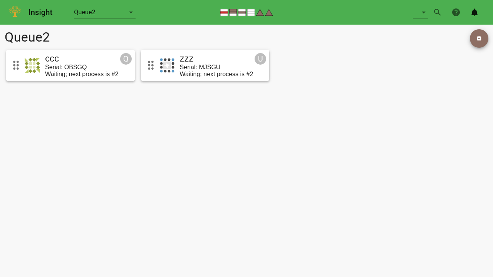
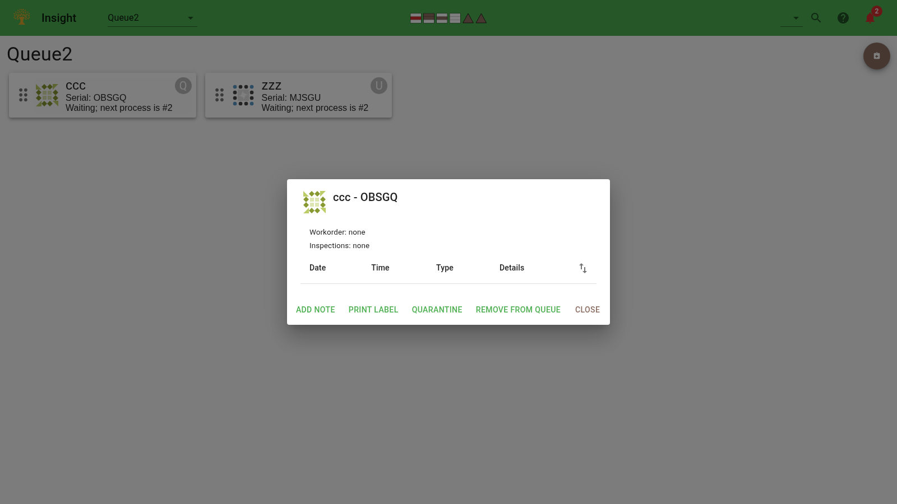
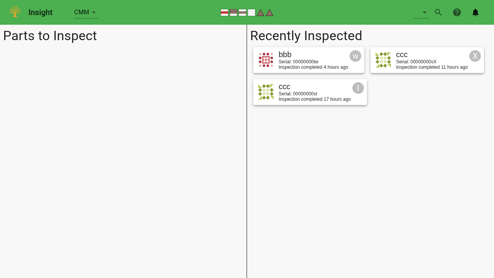
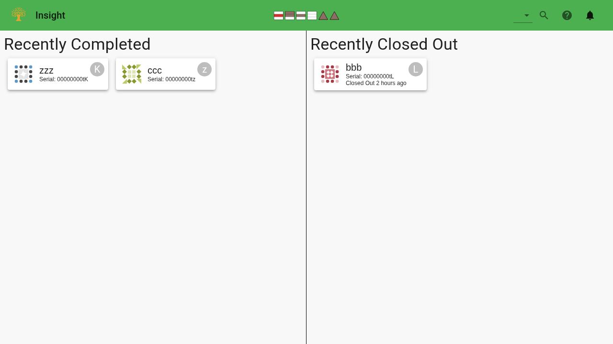

Station pages display the [virtual whiteboard of material cards](/fms-insight/material-tracking). A
card identifies a piece of material by part, serial, workorder, and signaled inspections when those
details are available. Tap a card to see its history and the actions available at the station. The
colored symbol identifies the part, and the large final character of the serial helps distinguish
nearby cards.

Bookmark the page for each station, including the selected station number and queues. A mounted
tablet or computer with a [barcode scanner](/fms-insight/client-scanners) lets operators compare the
display with the material in front of them. Station names, available actions, and terminology can
differ by installation.

## System Overview

The small machine and load-station symbols in the toolbar give a quick view of which stations are
occupied. Select them to open the system overview. It is also available as a dedicated station page
or from [Operations](/fms-insight/client-operations#cell).

The overview shows equipment, its current location or activity, and the material on it.
Installations with baskets also show basket positions and contents when supplied by the integration.
Select a material card for details.

## Load Station

Select the load station in the toolbar. Insight shows the relevant material, pallet faces, and
expected transfers. The toolbar also lets you display nearby queues and recently completed material.

Open a card to review its event history or instructions. The folder button opens the instructions
for the current load/unload work. Follow the [operator procedures](/fms-insight/operator-procedures)
if the displayed work cannot be completed as shown.

### Basket Work

Where the installation uses baskets, the station can show individual slots and instructions to load,
unload, or exchange their contents. A slot is a unit of handling and may contain more than one piece
of material. Arrows and destination labels show the intended movement. An **Unknown** slot is not a
confirmed empty slot.

Some basket work is confirmed directly in Insight. Review the displayed slots and complete the
physical work, then select **Confirm** when it becomes available. The page explains when work is
waiting or cannot yet be confirmed. If the work changes before confirmation, review the refreshed
instructions. A request to confirm an empty basket requires checking the physical basket is empty.

### Alarms and Unavailable Actions

The bell in the toolbar opens the alarm list. Some alarms are informational; others suspend changes
for the affected equipment or material. When changes are suspended, the page displays a warning and
disables the affected controls. Previously displayed instructions may remain visible as a reference;
follow the warning and your cell's recovery procedure before resuming work.

Material actions also depend on its current state. For example, a piece involved in an active load
cannot be removed from a queue as though it were idle. Where **Cancel Load** is offered, review the
whole instruction listed in its confirmation. See
[operator procedures](/fms-insight/operator-procedures) for quarantine, cancellation, and recovery.

## Queues

Select one or more queues in the toolbar. Drag a card's handle to change its position within a
queue. Movement between queues and removal are available only when the material's state permits
them. The order can influence material selection, but job and route requirements also apply.

Depending on the configuration, use the add button or scan a serial to introduce material. Raw
material queues may also show jobs awaiting material and unfilled workorders. Review the proposed
job, process, and destination before adding material.

Open a card, scan a barcode, or use the toolbar's serial search to see the material history.
Removing a card from a queue removes its current queue placement, while preserving the recorded
history.

## Inspection

The inspection page groups recently completed material by pending and recorded inspections. Select
an inspection type in the toolbar, or view all types. Open a material card to review its path
through the cell, open instructions, and record success or failure for the relevant inspection.

The selected operator name is attached to the result. Recording a result does not by itself move
physical material or decide its disposition; follow the installation's procedure for failed parts.
Serial lookup also works for material outside the recent display window.

## Close Out

Closeout is optional and records completion of final manual tasks, such as washing, final checks, or
workorder assignment. The page shows material unloaded from its final process in the last 48 hours,
with pending closeouts on one side and closeouts recorded in the last two hours on the other.

Open or scan a card to review the history, assign a workorder where supported, open instructions,
and record the closeout. Depending on the installation, scanning the serial or assigning a workorder
is required before completion is allowed. The selected operator is recorded with the result. Older
material can still be found by serial even after its card leaves the recent display.
