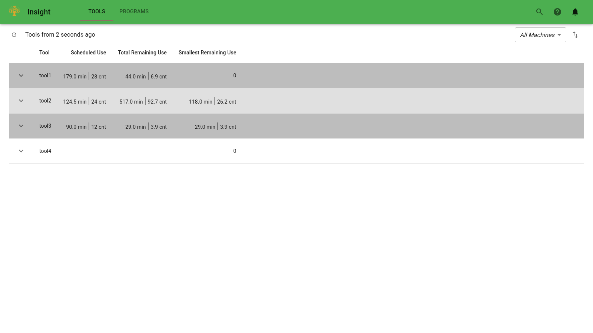
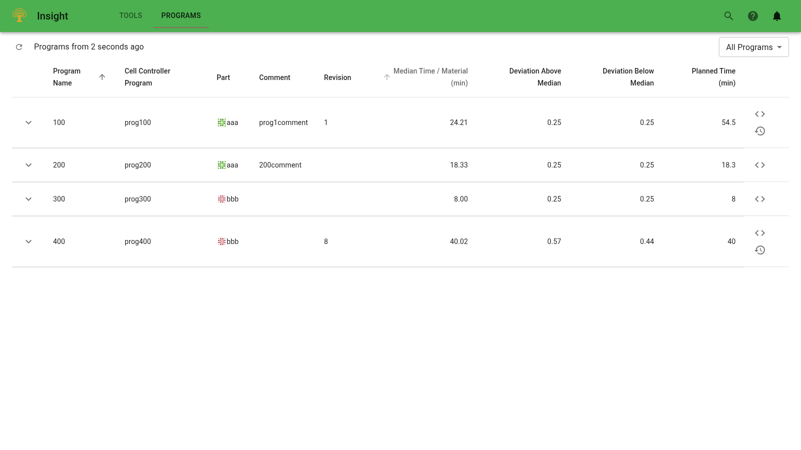

The Tools and Programs pages are intended for the tool room and engineers maintaining the cell's
programs. The same reports are available from [Operations](/fms-insight/client-operations#reports).
Tool data, program contents, and revision history depend on what the controller and integration
provide.

## Tool Report

Select **Load Tools** to request current tool data from the machines. Use the refresh button to load
it again; the table is a snapshot of the returned data.

For each tool, the summary compares estimated scheduled use with the remaining tool life on machines
relevant to the scheduled work. It shows both the combined remaining life and the smallest total on
an individual machine. Usage may be measured in time, counts, or both, depending on the controller.

Scheduled use is estimated from recent program executions. For a program already running, the
estimate includes the whole cycle because Insight does not know how far through the program it is. A
part may also be qualified on several machines, so the report cannot predict exactly which machine
will consume the tool life.

Expand a tool to see the machine pockets and scheduled parts behind the totals. Use those details
together with the cell's tool-management procedure to decide where replacement tools are needed.

## Program Report

Select **Load Programs** to request the current program list. The table includes the program name,
related part and process, and recent cycle-time statistics. Where supported, it also shows the
controller's program name or number and the revision used by downloaded jobs.

Median time and deviations describe the recent cycle-time distribution. Insight treats deviations
above and below the median separately because long interruptions differ from ordinary cycle
variation. Compare these with the expected times used for planning and investigate recurring
differences using the [cycle reports](/fms-insight/client-engineering).

Expand a row to see estimated tool use per execution. The estimate uses up to five recent cycles
within the typical time range; tool changes during a cycle can prevent a reliable usage estimate for
that tool. Buttons at the end of a row open program contents and revision history when available.
