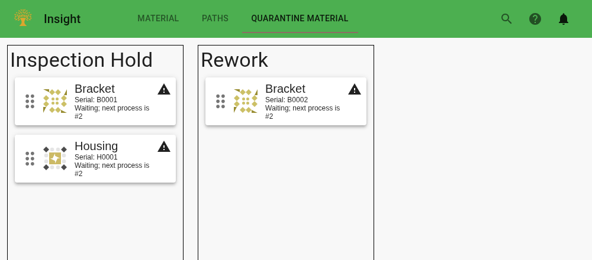

Quarantine is an optional part of [material tracking](/fms-insight/material-tracking). It keeps
material that cannot follow the normal production flow visible while someone decides what should
happen next. Typical reasons include further inspection, rework, or waiting for an engineering
decision.

## Queues for Material on Hold

The installation defines queues for production and for material on hold. These are regions on the
virtual whiteboard: each queue should have a clear physical meaning and someone responsible for
keeping it accurate. Queue roles supplied by the integration determine how the pages use them.

The configured initial quarantine queue receives material when it is quarantined. Additional queues
can describe the next action, such as waiting for inspection or undergoing rework. There is no need
for a separate queue for every possible problem; choose enough to show who needs to act and where
the material is.

The [Operations Material page](/fms-insight/client-operations#material) and the
[Quality Quarantine page](/fms-insight/client-quality#quarantine-material) show material on hold.
Open a card to review its history or add a note. Where permitted, drag the handle on the card to
move it between quarantine queues. Use the
[Queues station page](/fms-insight/client-station-monitor#queues) for changes to production queues.

## Putting Material on Hold

Direct quarantine moves material that is waiting in a queue into the initial quarantine queue.
Material already involved in station work or under automation control cannot be moved this way.

A quarantine signal is a request for the integration to handle material when it leaves automation
control. It does not immediately move a card, physically remove a part, or cancel a load. The
available actions and when a signal takes effect depend on the installation. Follow its procedure
and check the resulting queue and material status. See the
[operator procedures](/fms-insight/operator-procedures#quarantine-material) for the distinction
between signaling, moving, and cancelling work.

## Returning or Disposing of Material

Before returning material to production, bring it to the intended location and review the recorded
part, job, completed processes, and next operation. Then scan or enter its serial on the Queues page
and add it to the appropriate production queue. If a recorded process must first be corrected,
follow the [misload recovery procedure](/fms-insight/operator-procedures#recovering-from-misload).

If material will not return, record the disposition using the installation's procedure and remove it
from the queue. Queue removal means that Insight no longer lists it at that location; it does not
erase the history or by itself record a scrap decision. Notes can preserve the reason and reference
any associated quality records.
