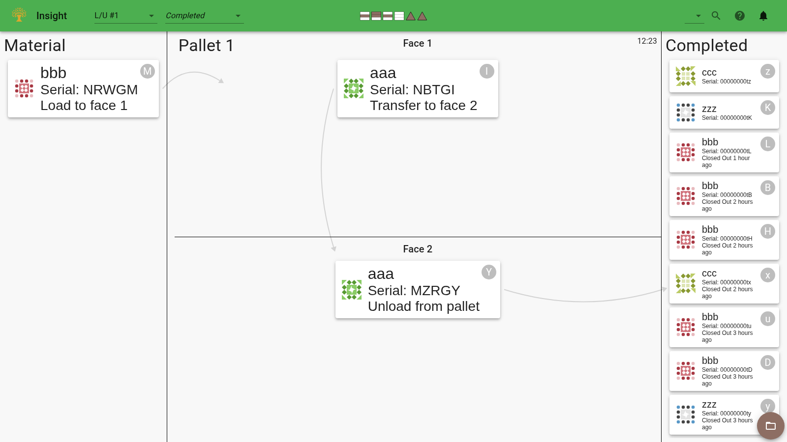

Material tracking connects the physical parts on the shop floor with their production records. It
helps operators identify what to load, gives inspectors the history of the piece in front of them,
and keeps material visible through manual work between automated operations. Where serials and
workorders are used, that record also supports traceability after material leaves the cell.

The central requirement is that the computer's view agrees with reality. Normal handling should be
straightforward, and there must be a clear way to reconcile the record when a part is removed,
reworked, or loaded differently than expected.

## Sticky Notes

Imagine a whiteboard divided into regions for the places where material can be: pallets, transfer
stands, raw material queues, inspection areas, and material on hold. Give each piece of material a
sticky note with its part name and serial. Write its history on the back. As the piece moves around
the factory, move its note to the corresponding region.

For example, when a part is unloaded after its first process, move its note from the pallet to the
transfer stand. When the part is loaded for its next process, move the note onto that pallet. Anyone
can compare the whiteboard with the shop floor to see what is available and what needs attention.

This is the model used by FMS Insight. Automation and operator input keep the virtual whiteboard
updated, while each material card provides access to the recorded history.

## Software-Based Sticky Notes

The [station pages](/fms-insight/client-station-monitor) show the section of the whiteboard relevant
to an operator. The load station shows material to load, unload, or transfer. Queue pages show
material waiting at a particular location. Inspection and closeout pages group recent material by
the work still to be recorded.

Insight updates cards as it receives events from the cell controller. An operator records manual
changes where needed, such as adding material to a queue, recording an inspection, or moving waiting
material to quarantine. A [barcode scanner](/fms-insight/client-scanners) or serial search opens the
record for a specific piece.

A material record and its serial label are related but distinct. Material can be tracked before a
serial is assigned, and correcting a label does not transfer another piece's manufacturing history.
Removing a card from a queue also preserves its history; the serial can be looked up again later.

## An Example Design

Consider a part with two machining processes and a manual inspection between them. The first process
unloads to an inspection input queue. The operator checks the part and, once it is released, records
its move to an output queue. The second process draws material from that output queue.

The queue contents tell the cell which material is available for the next operation. If a part is
set aside for further investigation, it stays out of the production input queue until it is ready.
[Quarantine queues](/fms-insight/material-quarantine) can keep that material and its disposition
visible.

The precise queue moves and inspection actions depend on the installation. Recording an inspection
result is distinct from moving material between queues. Design the physical handling and software
steps together so operators know which actions happen automatically and which they must record.

## Whiteboard Tracking Design

Start by mapping the physical flow and walking through it with sample parts or sticky notes. Decide
where material can wait, who is responsible for it, and what makes it ready for the next operation.
Then configure the corresponding queues and station views.

- **Raw material:** a job can assume material is available and create records at the first load, or
  use an input queue where operators record material before it is loaded.
- **In-process material:** use queues for transfer stands, conveyors, or manual work between
  automated processes. Keep the display near the physical location so mismatches are visible.
- **Pallets and baskets:** the integration supplies their locations, contents, and station work.
  Where baskets are used, individual slots identify the units of handling.
- **Inspections and closeout:** these pages help record checks and final manual work. They show
  recent activity, while serial lookup provides access to older material histories.
- **Exceptions:** agree how to hold, rework, release, and dispose of material. Use the
  [operator procedures](/fms-insight/operator-procedures) and the cell's own recovery instructions
  when a record needs correction.

A piece's location alone does not determine which actions are available. Material already involved
in a load, unload, or automated transfer is protected from conflicting queue changes. Always follow
the displayed instruction and available actions when reconciling the whiteboard.
