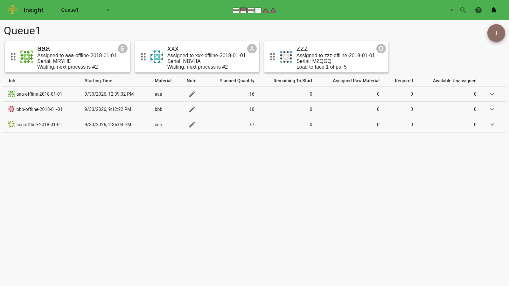

FMS Insight's [station pages](/fms-insight/client-station-monitor) show the material and work
relevant to each operator. Bookmark the appropriate station and select its queues. The screens use
the [whiteboard metaphor](/fms-insight/material-tracking): material cards should match the physical
material at the station. A [barcode scanner](/fms-insight/client-scanners) can help identify a
particular piece.

Available actions depend on the cell controller and installation. Use these pages to understand the
general workflow alongside the operating and recovery procedures supplied for your cell.

## Normal Loading and Unloading

The load station page shows the expected loads, unloads, and transfers between pallet faces or
basket slots. Check the part, serial, and destination against the physical material. Open a material
card for its history or instructions.

For a controller-managed pallet, complete the displayed work and use the controller's ready or load
button according to your cell's procedure. Insight updates when it receives the controller's
completion. Some installations also have
[basket station work](/fms-insight/client-station-monitor#basket-work) confirmed directly in
Insight.

Queue order helps choose which eligible material to load. A pallet's assigned job and route also
constrain the selection, so the first card in a queue is not necessarily the next piece to load.
Follow the specific material shown in the load instruction.

## Introducing Raw Material

Jobs can either assume raw material is available or draw it from a configured input queue. Without
an input queue, Insight creates material records as the initial loads complete. With an input queue,
the operator records the available material before it is selected for loading.

Bring the material to its designated location, then use the Queues page to scan or enter it.
Depending on the installation, material may be entered individually or in bulk, with or without
serials, and as a casting type or against a particular job. Review the proposed part, job, process,
and queue before adding it. The jobs and workorders shown on this page help determine what material
is needed.

Keep the queue display aligned with the physical queue. Reordering cards changes queue priority;
moving a card to another queue records a change of location. Material involved in an active load,
unload, or automated transfer cannot simply be removed or moved to another queue.

## Quarantine Material

[Quarantine](/fms-insight/material-quarantine) tracks material set aside for inspection, rework, or
a disposition decision. There are two distinct actions:

- **Quarantine Material** moves material that is waiting in a queue into the configured quarantine
  queue.
- **Signal For Quarantine** records a request for the integration to handle material when it leaves
  automation control. It does not immediately move the material or cancel a load.

Use the action available for the material's current state and follow the installation's instructions
for the physical move. When released material returns, verify its history and next process before
adding it to the appropriate production queue.

## When the Displayed Work Cannot Be Completed

Resolve a mismatch before acknowledging completion. Where **Cancel Load** is available, its
confirmation lists all material in the instruction that will be cancelled and recalculated. It can
affect more than the card you selected. Review the refreshed instruction before continuing.

Where cancellation is not offered, follow the controller-specific procedure for rejecting or
changing the load. A quarantine signal is not a substitute for cancelling an instruction. If an
alarm suspends changes, read the displayed reason and resolve it before continuing with the affected
work.

## Recovering From Misload

If completion has already been acknowledged, first reconcile the physical cell and controller using
the installation's recovery procedure. Depending on the integration, material removed from the
controller's pallet record may appear in a quarantine queue. Check the resulting Insight status
before making further changes.

If an incorrect recorded process needs to be invalidated and your installation enables this action:

1. Remove the affected material from its queue, including a quarantine queue, using the queue's
   material dialog. It must also be clear of active station work and automation control.
2. Look up the serial on the Queues page and choose **Invalidate Cycle**. Select the latest
   still-valid process and review every material identity listed in the confirmation. Invalidation
   affects whole recorded events, so other material on those events can be affected too. Insight
   rejects the change if any affected material is still in a queue or otherwise ineligible; review
   those pieces through the same recovery procedure before proceeding.
3. Review the refreshed history. If more than one process was recorded incorrectly, work backwards
   one process at a time. Changing a casting or job assignment first requires resolving any later
   processes.
4. Once the record matches the intended recovery state, add the material to the appropriate queue
   and verify the next process. Do this after invalidation, not before.

Invalidation retains the original events in the log but excludes them from active material
reconstruction. Removing material from a queue alone does not invalidate its history.

Insight does not transfer recorded pallet manufacturing history from one material identity to
another. If machining was attributed to the wrong identity, add an explanatory note and use the
installation's traceability exception procedure. Do not repeat machining solely to repair a record.
Correcting a serial label on the right material identity is a separate operation.
