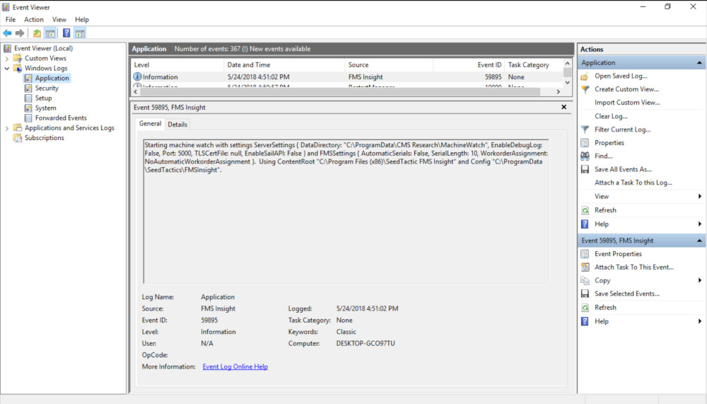
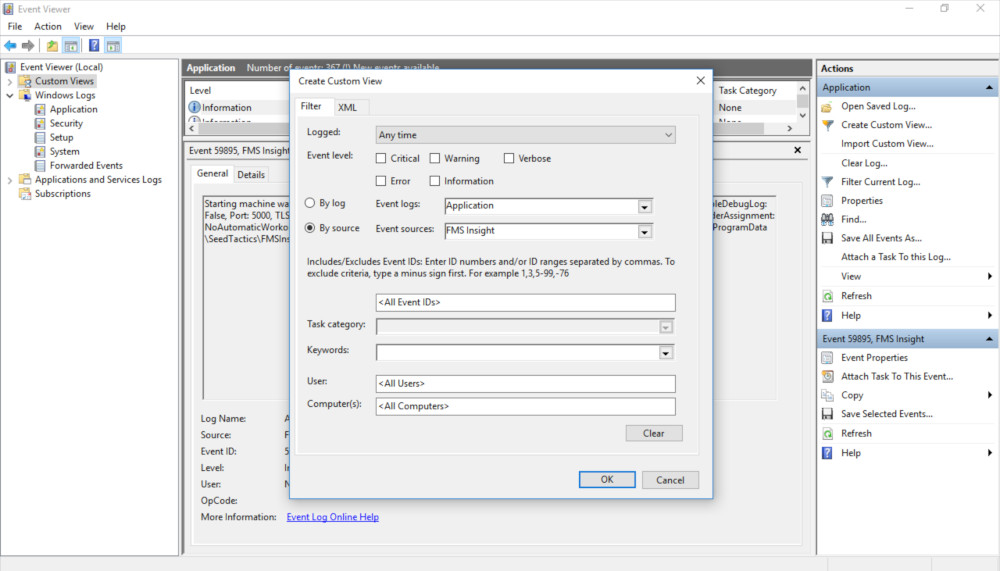

When the FMS Insight server encounters an error, it reports the error back over the network to the
software that requested the operation (such as the Insight client web page). The FMS Insight server
also logs more details on the computer running Insight, which may be the cell controller or a
separate server. For a Windows service installation, check the Windows Event Log. For other
deployments, check the console output captured by the service or container manager.

## Client Messages

If a material action is rejected, read the reason shown in the dialog and review the current status
before trying again. A load instruction may have changed, the material may no longer be eligible for
the action, or an alarm may be suspending changes. See the
[station guidance](/fms-insight/client-station-monitor#alarms-and-unavailable-actions) for alarms.

Configuration and startup failures can also appear in the client. Record the displayed message and
check the server log for the underlying cause. Resolving a configuration problem may require a
service restart; deleting the production database is not a general troubleshooting step. Follow the
[database recovery guidance](/fms-insight/server-config#backup-and-recovery) if stored state is
involved.

## Windows Event Viewer

The location of the viewer is different in different versions of Windows; on Windows 10 and 11, open
the start menu and search for "Event Viewer". To view the events in the event viewer, navigate to
"Windows Logs" and then "Application" in the tree on the left (see the screenshot below).

The Windows Event Viewer shows events from all applications. FMS Insight generates events with "FMS
Insight" as the event source, which allows you to create a custom view to filter only the events
from FMS Insight. To do so, go to the action menu, click "Create Custom View", and fill in "FMS
Insight" as the event source (see the screenshot below).

## Debug Log

To assist with debugging, FMS Insight has the ability to output a trace of activity with events for
almost all actions that FMS Insight takes. The debug trace is disabled by default because it
generates a lot of data. To enable it, edit the [config file](/fms-insight/server-config) and change
the setting "EnableDebugLog" to true. The FMS Insight server must be restarted before the config
setting takes effect. The debug trace log will be generated into the global AppData folder, which on
Windows defaults to `c:\ProgramData\SeedTactics\FMSInsight`. The JSON-formatted files have dated
names such as `fmsinsight-debug20261028.txt`, with a new file each day; older files may be
compressed. Remember to disable the trace log after a day or two because it generates a lot of data.
